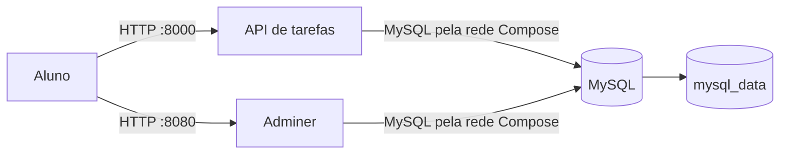

# ADR-001: MySQL sem porta publicada

- **Status:** Aceito
- **Contexto:** A API de tarefas e o MySQL estão na rede criada pelo Compose. A API acessa o banco pelo nome `db`; o computador do aluno só precisa acessar a API. O Adminer também roda como serviço na mesma rede.
- **Decisão:** Não publicar a porta 3306 do serviço MySQL. A administração será feita pelo Adminer, conectado à rede Compose, ou pelo terminal do contêiner.
- **Consequências:** O banco não fica diretamente acessível pela rede do computador e não disputa a porta 3306 com uma instalação local. A API e o Adminer continuam acessando `db:3306` pela rede interna. Essa configuração reduz os pontos de entrada e mantém o mesmo endereço do banco entre os serviços. Para consultar dados, o aluno usa o Adminer em `localhost:8080`; para tarefas administrativas, pode usar `docker compose exec db`. Se no futuro outro programa fora do Compose precisar acessar o banco, será necessário publicar a porta e rever essa decisão. Isso não é necessário para esta prática.

## C4 — Tarefas

