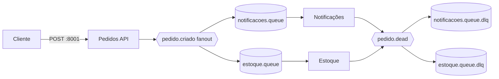

# ADR-002: Exchange fanout para o evento de pedido

- **Status:** Aceito
- **Contexto:** Notificações e estoque precisam reagir ao mesmo pedido, cada serviço no próprio ritmo. Nenhum deve depender de uma chamada direta ao outro, e ambos precisam receber cada evento.
- **Decisão:** Publicar `pedido.criado` em uma exchange fanout durável, ligada a uma fila durável por consumidor. Cada consumidor confirma a mensagem depois do processamento e envia mensagens inválidas, sem requeue, à sua própria DLQ.
- **Consequências:** Ambos os serviços recebem uma cópia e podem ficar indisponíveis sem impedir que a API aceite outros pedidos. Um consumidor novo pode ganhar sua fila e binding sem alterar os existentes. Em uma fila ponto a ponto, vários workers do mesmo tipo dividiriam o trabalho; cada pedido seria processado por apenas um deles, o que não atende a notificações e estoque simultaneamente. Fanout mantém filas e mensagens duplicadas, então usa mais recursos do broker e cada serviço precisa ser idempotente. Para esta prática, a independência entre os dois efeitos justifica esse custo.

## C4 — Pedidos

